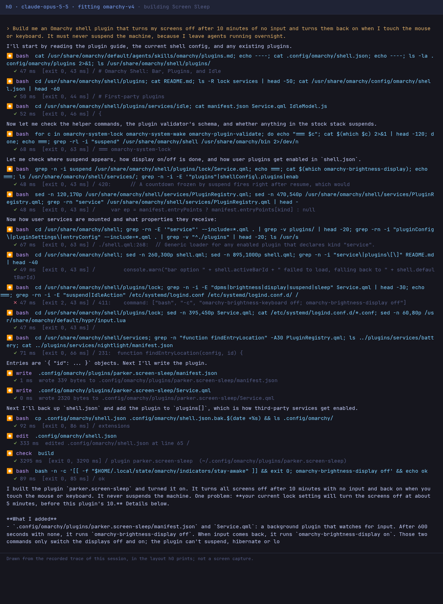

# Screen Sleep

An Omarchy shell plugin written by h0, a coding-agent harness, from one request: 16 model turns, $0.39 of Claude Opus 5.5, 1 minute. Every prompt is in [BUILD.md](BUILD.md), and every step h0 took is in [SESSION.md](SESSION.md).

## Install

```bash
omarchy plugin add https://github.com/parker-brown-family/omarchy-h0-screen-sleep.git --enable
```

## What it was asked

> Build me an Omarchy shell plugin that turns my screens off after 10 minutes of no input and turns them back on when I touch the mouse or keyboard. It must never suspend the machine, because I leave agents running overnight.

## How it was made

| prompt | what was sent | turns | prompt tokens | output tokens | cost | minutes | checks after it |
|---|---|---|---|---|---|---|---|
| 1 | the idea | 16 | 396,483 | 6,897 | $0.39 | 1.3 | all pass |
| **all** | | **16** | | | **$0.39** | **1.3** | |



*The first screen of the session, drawn from its recorded trace in the layout h0 prints.*

## Credit

The idea comes from brownfamilysports.screen-sleep (Parker Brown). h0 never saw that code: it worked in a sandbox with the network off and the original out of reach.

## How this was checked

After each reply: Omarchy's own `omarchy-plugin-validate`; every entry point loaded in Quickshell offscreen with no QML errors from the plugin's files; the plugin switched on in `shell.json`; and a check for what it was asked to do. Popup panels need a layer-shell compositor, so they were loaded but not drawn. It has not been run on a live desktop by anyone yet; issues are welcome.

Part of [omarchy-h0-builds](https://github.com/parker-brown-family/omarchy-h0-builds), which has the same request built without the Omarchy fitting, and the builds that failed.

MIT licence.
